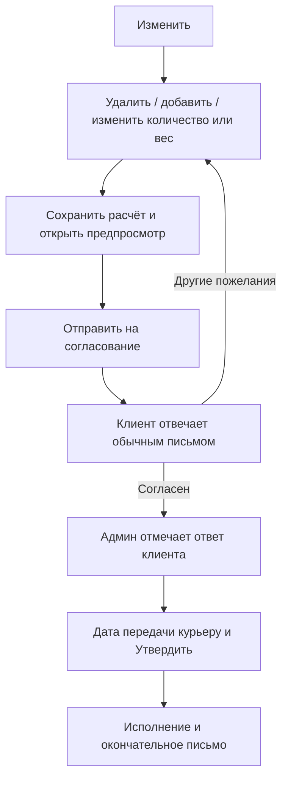

# Gastronom: утверждение и корректировка заказа

Дата: 12 сентября 2026. Ветка: `feature/order-approval-sandbox`.

## Статус результата

Подготовлен изолированный кандидат для проверки перед внедрением. Реализованы
интерфейс, согласование, ручные банковские операции, исполнитель с восстановлением,
резервы WooCommerce, адаптеры Dotypos/Packeta/GLS, почтовый outbox и операционный экспорт.
Исходные позиции и сумма WooCommerce сохраняются.

В проверочной среде все заказы вымышленные. Внешние HTTP-запросы и письма блокируются;
для проверки транспортов используются локальные ответы. WordPress 6.9.7 и WooCommerce
10.6.2 работают на отдельных чистых SQLite-базах posts и HPOS. Проверяются также
настоящие классы формирования отправлений Packeta/GLS. Полный производственный набор
плагинов, реальная касса и реальная доставляемость почты здесь не проверялись.
Автономный HTML исполняет тот же PHP-модуль через WebAssembly.

Установка файлов сама по себе ничего не включает. Нужны явный release-флаг,
production-окружение и время начала новой схемы. Эти настройки **не установлены
на рабочем сайте**. Порядок включения и обязательная проверка внешних систем описаны
в [инструкции внедрения](RELEASE-RUNBOOK.md).

## 1. Согласованная схема

### Основная карточка

В центральной части только:

1. Имя, телефон, email, адрес заказчика.
2. Способ оплаты, факт и сумма полученных денег; при расхождении — остаток к
   оплате или возврату.
3. Выбранный способ доставки.
4. Явный статус, дата передачи курьеру, кнопки «Утвердить» и «Изменить».
5. Товары, количество/вес, цены, доставка и итог.

После утверждения видны результат отправки подтверждения и дата передачи
курьеру. При ошибке письма доступен повтор только письма; при ошибке исполнения —
повтор только исполнения. История и служебные метаданные не занимают основную
карточку. Поля IBAN и отметка ручного перевода доступны только при сумме к возврату.

Правые блоки Packeta/GLS сохраняются. Дублирующее уведомление `rusky-shipping-notice-email` удаляется для заказов новой схемы; его старый отправитель блокируется. Дата и окончательное подтверждение находятся в основном блоке.
В демонстрации они обозначены схематично, а не скопированы с рабочего сайта.

### Обычный заказ


Оплата клиента фиксируется независимо от утверждения. Получение оплаты не
должно автоматически запускать фискализацию или окончательное складское
списание в новой схеме.

### Заказ с корректировкой



Панель коррекции закрыта до «Изменить». У каждой отправленной версии свой номер.
Любое дальнейшее редактирование сбрасывает согласие. Администратор указывает
дату/ссылку на ответ клиента. Автоматический анализ почты не требуется.

Для первой версии используется один конкретный предлагаемый состав. Можно
заменить несколько отсутствующих товаров. Взаимоисключающие варианты не
складываются в одну сумму: при выборе другого варианта создаётся новая версия.
Если удалены все товары, предлагается полная отмена с нулевой доставкой и сборами. После согласования администратор утверждает отмену: чек продажи не создаётся, резерв освобождается, предоплата возвращается вручную.

## 2. Данные и денежные правила

Исходный заказ WooCommerce хранит первоначальные позиции и первоначальную сумму.
Корректировка хранится в отдельном `_gor_state` через CRUD WooCommerce. Исходные
позиции не удаляются, исходная сумма не переписывается, возвраты через шлюз не
создаются.

Состояние содержит исходный снимок, текущий проект, утверждённый снимок, номер
версии записи и предложения, подтверждение клиента, оплату, ручные операции,
дату передачи, исходящие письма и историю действий.

Деньги — целые евроценты. Количество/вес — тысячные доли единицы. Ввод не
принимает отрицательные значения, экспоненты, NaN и лишние знаки после запятой.
Штучные товары имеют целое количество; весовые — до 0,001 кг.

Формула:

```
Новый итог = суммы товарных строк + доставка + сборы
Остаток = новый итог − (исходная оплата + дополнительные платежи − возвраты)
```

Положительный остаток означает сумму к получению, отрицательный — к возврату.
Ручной возврат меняет остаток денег, но не вычитает сумму второй раз из нового
итога заказа. Исходные скидки уже учтены в суммах строк. Для неизменённых строк
сохраняется точная сумма, даже если цена одной единицы округлена.

Доставка и сборы при отсутствии товара сохраняются по исходному заказу. Цена
замены берётся из каталога как предложение; администратор может скорректировать
её в панели. Налоговая сумма в клиентском расчёте включена в цену. Налоговые
правила фискального документа должны быть проверены через реальные товары
Dotypos на этапе 6.

Отчёты WooCommerce при такой архитектуре остаются отчётами первоначальных
заказов. Их нельзя использовать как итоговый регистр фактической выручки после
коррекций. Реестр Gastronom должен явно показывать исходный итог, согласованный
итог, поступившие деньги, возвращённые деньги и остаток.

## 3. Предоплата и ручной возврат

| Сценарий | Правило |
|---|---|
| Оплата при получении | В доставку передаётся только согласованный остаток к получению |
| Предоплата равна новому итогу | Утверждение без дополнительных денежных действий |
| Предоплата больше нового итога | Регистрируется обязательство вернуть разницу |
| Предоплата меньше нового итога | Утверждение заблокировано до поступления разницы |
| Перевод частями | Каждый перевод отмечается отдельно, остаток пересчитывается |

Перевод выполняет человек в банковском приложении. Система только хранит факт:
сумма, IBAN, имя владельца, согласие клиента, банковский номер операции. Одинаковый
номер перевода нельзя учесть повторно. Сумма не может превышать остаток к возврату.

Состав может быть утверждён до фактического ручного возврата: обязательство
возврата остаётся видимым. Статус «Утверждён» не означает «Возврат выполнен».

IBAN карточного плательщика не извлекается из карточного платежа. В письме
запрашиваются реквизиты и согласие на банковский способ возврата. Известный IBAN
в письме маскируется (страна и последние четыре символа); полный хранится только
в административных данных. Проверяется длина страны и контрольная сумма mod-97.
Это проверка формата, не принадлежности счёта человеку.

## Уточнения интерфейса от 12–13 сентября

- Кнопка «Утвердить» недоступна без допустимой даты передачи курьеру; серверная проверка также сохранена. Самовывоз не требует даты.
- Фактический вес вводится отдельно от коррекции состава. Используются `_gastronom_weight_min_kg` и `_gastronom_weight_max_kg`, сохранённые на позиции заказа, с количеством заказанных единиц. Если диапазон отсутствует, требуется проверить данные; подставлять произвольный диапазон нельзя.
- Поле ручного описания изменений удалено; комментарий клиенту необязателен.
- Язык письма: только явная отметка `ru` включает русский; во всех остальных случаях `sk`.
- Демонстрация и кандидат используют одни исходники.

## 4. Письма

### Заказ получен

Первичное сообщение не является окончательным утверждением. Для новой схемы
заголовок говорит о получении заказа и проверке наличия.

### Согласование

Автоматический русский/словацкий шаблон включает:

- вежливое пояснение причины, извинение при отсутствии товара;
- только новый состав с суммами и краткое описание изменений;
- новый итог, уже оплаченную сумму, точную разницу;
- запрос IBAN и согласия, когда нужен банковский возврат;
- просьбу ответить обычным письмом;
- пояснение, что дальнейшая обработка ждёт ответа.

Варианты текста выбираются автоматически: обычное подтверждение, замена, уточнение веса, замена с уточнением веса. Изменения по просьбе клиента не описываются как отсутствие товара. Вес в сохранённом диапазоне уточняется прямо в заказе без отдельного согласования.

### Окончательное подтверждение

Формируется только после успешного исполнения утверждения. Содержит окончательный
состав, итог, оплату, доставку и **планируемую дату передачи курьерской службе**.
Это не дата доставки клиенту. При самовывозе дата курьеру не требуется.

Письмо сохраняется в исходящем журнале. Повторная отправка использует сохранённый
текст, а не пересобирает его из более поздних данных. Успех транспорта не
равнозначен подтверждённой доставке в почтовый ящик клиента: при подключении
реального транспорта интерфейс должен различать эти значения.

Старое отдельное уведомление `rusky-shipping-notice-email` не используется для новых заказов. Собственные функции и уведомления перевозчиков не удаляются.

## 5. Реализованные компоненты и проверки

| Компонент | Файл / результат |
|---|---|
| Состояния, расчёты, согласование, банковские операции | `src/Review.php` |
| Письма RU/SK | `src/Mail.php` |
| Подготовка точного чека, списания и данных доставки | `src/Fulfillment.php` |
| Резервы каталога и защита конкурирующих заказов | `src/StockHolds.php`, `src/Reservations.php` |
| Исполнение и сверка потерянного ответа | `src/Executor.php`, `src/DotyposTransport.php`, `src/LiveAdapter.php` |
| Данные перевозчиков | `src/Carriers.php` и узкие изменения серверных vendor-адаптеров |
| Доставка писем и восстановление | `src/Outbox.php`, `src/Operations.php` |
| REST, блок карточки, CRUD-метаданные, тестовый журнал | `src/WordPress.php` |
| Интерфейс | `assets/review.js`, `assets/review.css` |
| Запрет старых автоматических обработчиков для новых заказов | Постоянный MU-guard и точечные проверки старых обработчиков |
| Автономная проверка в браузере | `Gastronom-review-offline.html` |

Проходы проектирования и проверки:

1. Проверены обычный и исправляемый заказ, оплата, вес, дата, согласование.
2. Проверены повторные запросы, устаревшие вкладки, частичные возвраты, сбой
   отправки и сбой исполнения; исправлены обработка пустого журнала эффектов,
   округление неизменённой строки и позднее поступление оплаты.
3. Проверен настоящий браузер с автономным PHP, предпросмотр письма,
   предоплаченный заказ со сбоем кассы, мобильная компоновка и отсутствие внешних
   сетевых запросов. Исправлена ширина товарной таблицы на узком экране и
   предупреждение безопасности локального iframe; предпросмотр использует
   изолированный data-документ.
4. Дополнительно выполнены интеграционные проверки на настоящих WordPress/WooCommerce
   в posts и HPOS. Проверены CRUD-метаданные, исходные суммы, права администратора,
   регистрация панели, сохранение правых metabox-регистраций и REST-поиск товаров.

## 6. Исполнитель кассы и склада

Реализованы `Executor`, `DotyposTransport` и подключение существующей авторизации
через `LiveAdapter`. В sandbox тот же исполнитель получает локальный транспорт.

1. До сохранения утверждения проверяется представимость суммы на кассе. Ошибка
   привязки товара или округления оставляет состав доступным для исправления.
2. Утверждённый план с привязками SKU и массой фиксируется отдельно. Изменение
   каталога позже не меняет содержимое уже утверждённого задания.
3. Исполнитель сначала ищет чек по `externalId`. Сверяет кассу, валюту, сумму,
   состав, оплату, фискальные флаги и признак складского списания строк.
4. Перед единственным запросом создания сохраняет состояние `sending`.
   Таймаут, аварийное завершение или неоднозначный ответ переводят операцию в
   сверку. Отсутствие чека в ещё не синхронизированном облаке **не разрешает повторную
   продажу**. Кнопка повтора снова проверяет результат.
5. После подтверждённого чека читаются актуальные остатки Dotypos. Проверяется,
   что версия остатка не старше завершения чека. В Woo записывается абсолютное
   значение. Второго запроса продажи/списания нет.
6. Сбой чтения склада не создаёт повторный чек. Резерв сохраняется до успешного
   завершения синхронизации. Только затем создаётся окончательное письмо.
7. Для полной отмены этот путь не вызывается: нет продажи, списания или доставки.

`idempotency-key` оставлен для корреляции, но не используется как доказательство
однократности. Документация описывает его для повторных webhook-вызовов.
Также явно отключены дополнительные скидки и необязательные модификаторы POS,
чтобы касса не изменила согласованный расчёт.

Внешнюю фискализацию и налоговые настройки конкретной кассы проверяют при
разрешённом внедрении; локальные ответы API не являются подтверждением работы
реального фискального устройства.

## 7. Резерв, доставка, почта и отчётность

### Резерв

Регистр `gor_stock_holds` подключён к classic checkout и Store API checkout.
Уникальная блокировка базы сериализует конкурирующие изменения. WooCommerce
учитывает регистр в запросе зарезервированного количества. Собственный заказ
исключается из расчёта; второй покупатель не может занять последнюю единицу.
Резерв не меняет физический остаток.

До взвешивания резервируется число упаковок по максимальной массе. После взвешивания
сохраняются фактические килограммы и консервативное число упаковок для Woo.
Списание выполняется по фактическому весу. Остатки штучных и весовых товаров не
смешиваются. Старые весовые резервы и обработчики новых заказов отключены.

При корректировке резерв заменяется, при согласованной отмене освобождается,
при выполнении закрывается после синхронизации. Неоплаченный заказ освобождает
резерв при штатной отмене/ошибке Woo; оплаченный заказ, ожидающий ответа клиента,
не отменяется автоматически. Аварийные блокировки требуют проверки остановившегося
обработчика, а не автоматического удаления по таймеру.

### Перевозчики

Блоки перевозчиков сохранены. Отдельный блок старого уведомления о дате удалён для новых заказов.

- Packeta получает внутренний ID через Entity::number, а не через пользовательский
  номер. Старые ручные суммы/COD не переопределяют согласованную стоимость. Ручная
  масса упаковки сохраняется, но экспортируемая масса не может быть меньше массы
  утверждённых товаров. `deliverOn` не подменяется датой передачи курьеру.
- GLS получает согласованный COD и стоимость для одиночного и массового экспорта,
  страхования и шаблона содержимого. Для предоплаты COD отсутствует. Неподдерживаемые
  поля массы в API не добавляются.
- Экспорт до утверждения, после отмены и при отключённом модуле заблокирован.
  Ошибка Packeta проходит через её штатный InvalidRequestException.

### Почта

`Outbox` сохраняет неизменяемый текст, адрес получателя и Reply-To до обращения
к транспорту. Отказ транспорта допускает повтор письма. Неопределённый результат
требует сверки почтового журнала. Повтор не запускает кассу. Старую версию предложения
нельзя отправить после изменения состава.

Первичное письмо Woo заменено на уведомление об ожидании проверки наличия в HTML
и plain text. Предложение содержит исходный состав, новый состав, разницу стоимости,
полученные деньги и остаток к возврату/доплате. Подтверждение содержит дату передачи
курьеру; отмена имеет отдельную тему. Письмо фактической отправки остаётся штатным.
Состояние «отправлено» означает принятие почтовым транспортом, не прочтение клиентом.

### Отчётность и восстановление

Личный кабинет явно отличает первоначальный заказ от согласованного результата.
Команда `wp gastronom-review export --from=YYYY-MM-DD --to=YYYY-MM-DD` выдаёт JSONL
с исходной и утверждённой суммой, полученными/возвращёнными деньгами, остатком,
ссылкой на чек и ручными банковскими операциями. Обычные отчёты Woo продолжают
показывать исходные суммы и не заменяют этот операционный реестр.

`wp gastronom-review recover ORDER_ID --evidence="..."` восстанавливает доступ
к сверке после проверенного прерывания PHP-запроса. Она не создаёт чек и не
разрешает повторную продажу после неопределённого результата. Журнал и версия
сохраняются. Детальный порядок — в инструкции внедрения.

## 8. Что происходит дальше

1. Выполнить весь локальный набор проверок и сохранить проверяемый release-пакет
   с хешами файлов и исходной базой сравнения.
2. Пользователь проверяет автономную демонстрацию и письма. Включение магазина
   этим не подразумевается.
3. После прямого разрешения пользователя — сверить актуальные файлы/версии магазина,
   создать резервную копию, применить минимальный пакет и зафиксировать UTC-порог.
4. Проверить внешний путь касса → склад → почта и данные перевозчиков на
   контролируемом заказе. Только реальный сервис подтверждает фактический внешний
   результат. При расхождении исполнение останавливается и сверяется.
5. Наблюдать первые заказы новой схемы. Старые заказы не мигрировать.

Постоянный `rusky-order-review-guard.php` сохраняет принадлежность заказов новой
схеме даже при отключении интерфейса. Удалять его, `gor_review_cutoff` и сохранённые
снимки при откате нельзя: старый обработчик иначе использует первоначальные суммы.

## Запуск и воспроизводимость

Без сервера: открыть `Gastronom-review-offline.html` в Chrome. Данные вымышленные,
сохраняются только в памяти вкладки; перезагрузка сбрасывает демонстрацию.
Файл включает PHP WebAssembly (~24 MB), поэтому сеть ему не нужна.

Разработчику:

```sh
node tools/order-approval-sandbox/run-php.mjs
node tools/order-approval-sandbox/run-php.mjs tests/order-review/integration.php
node tools/order-approval-sandbox/run-php.mjs tests/order-review/contracts.php
node tools/order-approval-sandbox/run-php.mjs tests/order-review/lint.php
node tools/order-approval-sandbox/test-ui.mjs
node tools/order-approval-sandbox/test-wordpress.mjs
node tools/order-approval-sandbox/build-offline.mjs
```

Опционально локальный HTTP-сервер: `node tools/order-approval-sandbox/server.mjs`.
Он слушает только `127.0.0.1:8787`, использует тот же PHP и не нужен для HTML-версии.
Его сетевой запуск в текущей ограниченной shell-среде не проверялся.

Зависимости зафиксированы в `tools/order-approval-sandbox/package-lock.json`;
установка: `npm ci --prefix tools/order-approval-sandbox`.
